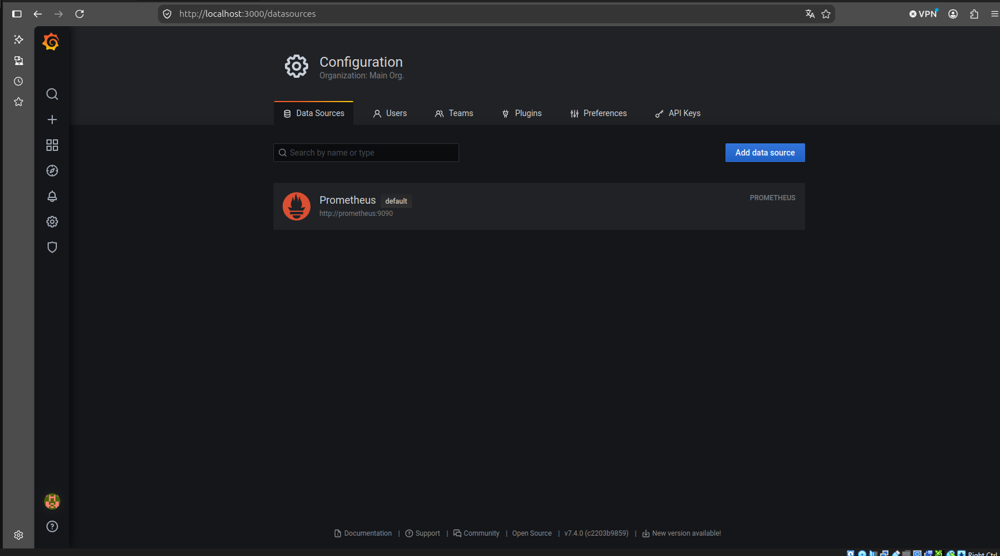
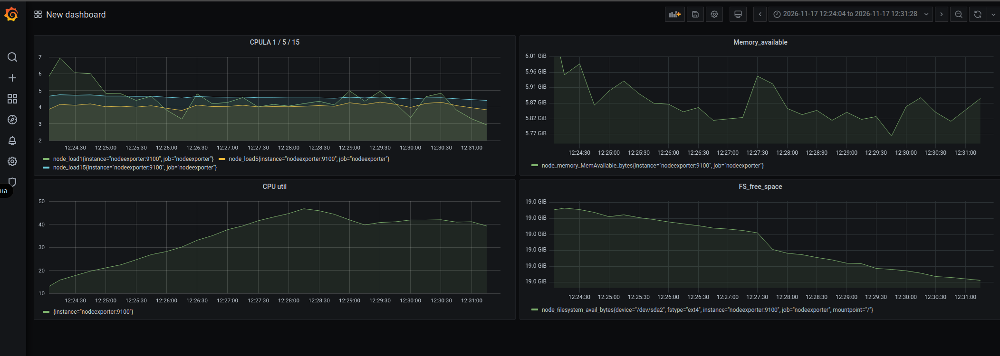
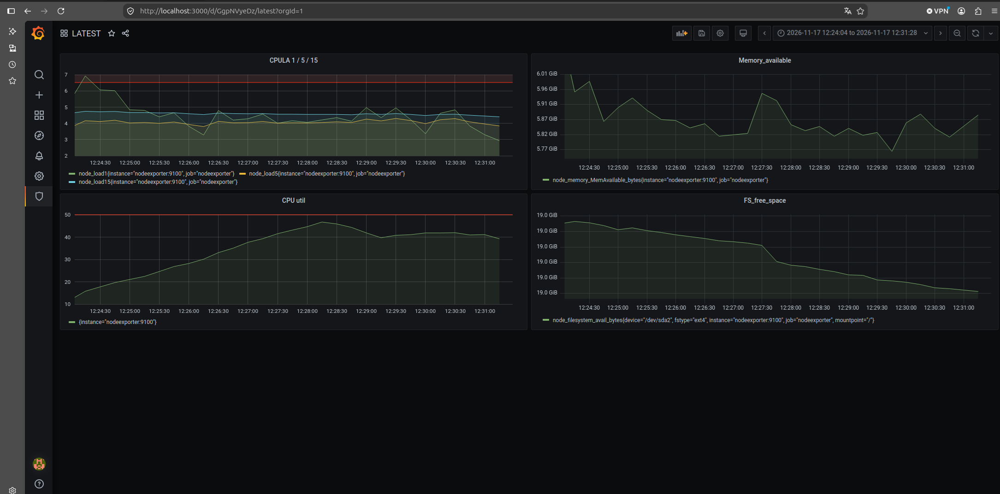

# \[Фамилия Имя Отчество\]

# Домашнее задание «Мониторинг: Prometheus и Grafana»

## Задание 1. Запуск Prometheus и Grafana

1.  В директории `help` проекта запущена связка Prometheus и Grafana с
    помощью Docker Compose.
2.  Выполнен вход в веб-интерфейс Grafana с учётными данными из
    `docker-compose.yml`.
3.  Prometheus подключён в Grafana в качестве источника данных (Data
    Source).
4.  Проверено подключение источника данных.

### Скриншоты



## Задание 2. Создание Dashboard и Panels

Создан Dashboard с названием `LATEST`. В него добавлены четыре панели
для мониторинга ресурсов узла `nodeexporter`.

### 1. Утилизация CPU

PromQL-запрос:

``` promql
100 * (1 - avg by (instance) (
  rate(node_cpu_seconds_total{mode="idle"}[5m])
))
```

Запрос рассчитывает загрузку CPU в процентах как `100 - idle`.

### 2. CPULA 1 / 5 / 15

В одной панели отображаются три временных ряда:

``` promql
node_load1
```

``` promql
node_load5
```

``` promql
node_load15
```

Они показывают среднюю системную нагрузку за 1, 5 и 15 минут
соответственно.

### 3. Количество свободной оперативной памяти

PromQL-запрос:

``` promql
node_memory_MemAvailable_bytes
```

Метрика показывает доступную оперативную память. Для отображения объёма
в настройках поля выбрана единица измерения GiB (Gibibytes).

### 4. Количество свободного места на файловой системе

PromQL-запрос:

``` promql
node_filesystem_avail_bytes{fstype!~"tmpfs|overlay"}
```

Метрика показывает доступное место на файловых системах, исключая
`tmpfs` и `overlay`.

### Скриншоты



## Задание 3. Настройка Alert

Для Dashboard настроены правила оповещения:

-   **CPULA 1 / 5 / 15 alert** --- условие срабатывания при среднем
    значении выше `6.5`, период `10m`, проверка каждые `5m`.
-   **CPU util alert** --- условие срабатывания при среднем значении
    выше `50`, период `5m`, проверка каждую `1m`.

### Скриншоты



## Задание 4. Сохранение Dashboard в JSON

Dashboard сохранён в формате JSON через меню настроек Dashboard → **JSON
Model**. JSON-конфигурация содержит описание Dashboard и его панелей,
PromQL-запросы, параметры отображения и правила оповещения.

Основные параметры сохранённой конфигурации:

-   Название Dashboard: `LATEST`.
-   Версия Grafana: `7.4.0`.
-   `schemaVersion`: `27`.
-   UID Dashboard: `GgpNVyeDz`.

### Скриншоты

Скриншот для этого задания не предоставлен. JSON-файл Dashboard
необходимо приложить в корень репозитория отдельно от данного отчёта.
